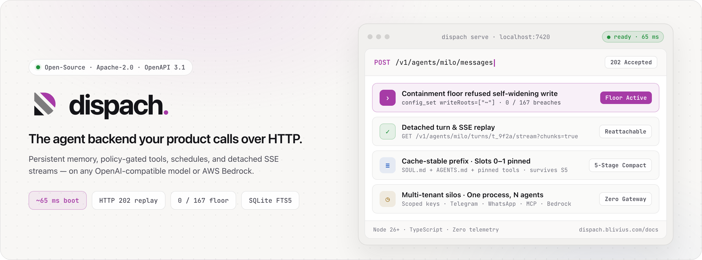
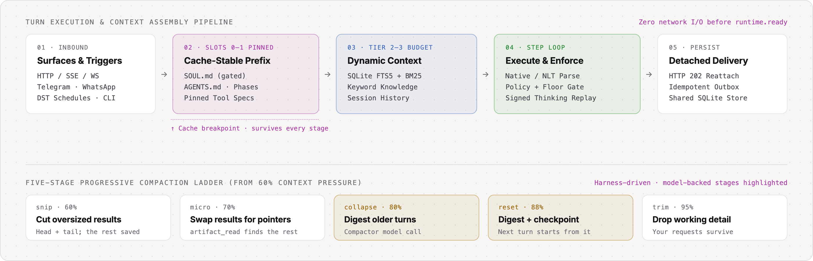

<div align="center">

<a href="https://dispach.blivius.com">
  <picture>
    <source media="(prefers-color-scheme: dark)" srcset="https://raw.githubusercontent.com/blivius/dispach/HEAD/.github/assets/banner-dark.png">
    <source media="(prefers-color-scheme: light)" srcset="https://raw.githubusercontent.com/blivius/dispach/HEAD/.github/assets/banner-light.png">
    
  </picture>
</a>

<br>

**The agent backend your product calls over HTTP.**
Open source and self-hosted: one API for agents with memory, tools, schedules, channels, and approvals, on any OpenAI-compatible model or AWS Bedrock.

<p>
  <a href="LICENSE"></a>
  <a href="https://github.com/blivius/dispach/actions/workflows/ci.yml"></a>
  <a href="https://www.npmjs.com/package/dispach"></a>
  <a href="https://arxiv.org/abs/2610.06274"></a>
  <a href="https://hub.xerj.org/contributors/moeen-mahmud"></a>
</p>

<p>
  <a href="https://dispach.blivius.com/docs"><strong>Docs</strong></a> ·
  <a href="#quickstart">Quickstart</a> ·
  <a href="#call-it-over-http">HTTP API</a> ·
  <a href="#architecture">Architecture</a> ·
  <a href="#benchmarks">Benchmarks</a> ·
  <a href="https://arxiv.org/abs/2610.06274">Research</a> ·
  <a href="CHANGELOG.md">Changelog (<!-- fact:version -->0.2.13<!-- /fact -->)</a> ·
  <a href="CONTRIBUTING.md">Contributing</a>
</p>

</div>

---

| **~65 ms** boot | **125 / 125** on 5 of 11 models compared | **0 / 167** floor breaches | **<!-- fact:endpoints -->90<!-- /fact -->** OpenAPI 3.1 endpoints |
| --- | --- | --- | --- |
| Zero network I/O before `runtime.ready` ([`bench:boot`](#boot-budget)) | Head-to-head multi-turn tool benchmark ([`evals/harness`](evals/harness/README.md)) | Measured settings containment floor ([arXiv 2610.06274](https://arxiv.org/abs/2610.06274)) | Detached `HTTP 202` turns, SSE/WS replay, scoped keys |

> To dispatch is to send a thing on its way with the authority to see it done: to decide
> what handles it, hand it over, and answer for the result.

Your backend calls one API. Dispach runs the agents, each with its own memory and settings, on
infrastructure you control and on models as small as local ones.

- Every turn is detached and reattachable.
- Every write takes an idempotency key.
- The wire contract is published as OpenAPI 3.1 and checked in CI.
- One process hosts many agents, and scoped keys fence each one off.

TypeScript, shipped on Node, Apache-2.0.

**Research:** [*What May an Agent Change About Itself? A Containment Floor for Self-Configuring Agent
Runtimes*](https://arxiv.org/abs/2610.06274) (Hossain and Mahmud, 2026, preprint) measures the floor in
Dispach's settings tool. With it in place, **0 of 167** protected writes were saved, though the models
attempted one in 65 of those cases.

**Where it is going: the multiplayer agent runtime.** 0.2.x gives every user and every team in your
product their own isolated runtime of agents. Those agents share rooms and memory with the people
they work for, and stand in for them, openly, when they are away.

That half ships in 0.2.x as **experimental**: on the HTTP API and the browser console (no TUI
screens yet), and it may change within 0.2.x. Everything else described in this README is stable.

**Quick links:**
[New in <!-- fact:version -->0.2.13<!-- /fact -->](CHANGELOG.md) ·
[New since 0.2.0](developer-docs/runtime/whats-new-since-0-2-0.md) ·
[Limits & evidence](developer-docs/runtime/limits-and-evidence.md) ·
[Good first issues](https://github.com/blivius/dispach/labels/good%20first%20issue) ·
[Help wanted](https://github.com/blivius/dispach/labels/help%20wanted)

---

## Quickstart

### Local CLI & TUI

```bash
curl -fsSL https://dispach.blivius.com/install.sh | sh
#   or: npm i -g dispach (Node <!-- fact:node -->26.13.0<!-- /fact -->+) · brew install blivius/tap/dispach
dispach init          # name the agent, pick a model, paste a key
dispach run milo      # talk to it in the terminal
```

<div align="center">
  
</div>

*Told to widen its own write access to `~`, the agent makes the call and the runtime refuses it. An
agent may grant itself abilities, never reach. That floor is measured in the research above.*

### Or run it as a server

One `docker run`, and [Call it over HTTP](#call-it-over-http) creates an agent and streams its reply in three requests:

```bash
docker run -d --init -p 7420:7420 -v dispach-home:/home/dispach \
  -e DISPACH_API_TOKEN=pick-a-secret ghcr.io/blivius/dispach:0.2.13
```

- **The named volume** is where the store, every agent and every key live. Without it, a
  `docker rm` for an upgrade starts empty.
- **`--init`** is there because `exec` backgrounds children, and a child whose parent is PID 1 has
  nothing to reap it.

<details>
<summary><strong>Watch the standalone installer demo & read how <code>dispach init</code> works</strong></summary>

<br>


```bash
dispach init          # an interactive wizard: your name, the agent's name, an endpoint
dispach run milo      # agents live in ~/.dispach/agents; run them by name, from anywhere
dispach run           # or just this: picks from your agents, or walks you through creating one
```

`init` writes a complete starter agent and validates it with the real loader before exiting:

- a reference-style manifest
- a `SOUL.md` identity pair
- an `AGENTS.md` operations file
- the tiered workspace
- `.env`

It asks for your API key at the prompt, masked, and writes it to the gitignored `.env` beside the
manifest. `agent.yaml` only ever names the variable.

No flag accepts a key, because one passed on the command line lands in shell history. A scripted
run (`init --user Ada --name Scout --preset ollama --yes`) leaves the line blank and says where to
fill it in.

**`--preset` carries the endpoints worth not typing from memory:** OpenAI, Anthropic, DeepSeek,
OpenRouter, Groq, NVIDIA NIM, Ollama both local and hosted, and AWS Bedrock. `custom` is a
first-class answer for anything else. The web console's Models page offers the same list.

- **Any OpenAI-compatible `/chat/completions` endpoint works.** The transport has no provider
  branch: one POST, one body builder.
- **A preset gets the base URL's *shape* right**, which is the part that is easy to get wrong. It
  must end at the version segment. The runtime appends `/chat/completions` itself, so a URL copied
  from a provider's docs with the full path is refused.
- **Bedrock is the one preset that is not three strings.** `--preset bedrock --region eu-west-1`
  writes `api: bedrock-converse` and `options.region`, with no URL and no key variable. Credentials
  come from the AWS default chain (environment, a named profile, the container or instance role).
- **Local Ollama and Ollama Cloud are two presets on purpose.** Local needs no key: the absent
  `apiKeyEnv` makes the manifest omit the field and the provider send no `authorization` header at
  all. The hosted endpoint needs one. With a single preset, the obvious move (choose it, then edit
  the base URL to the hosted endpoint) produced a keyless manifest with no route to a key short of
  hand-editing the field back in.

**You talk to an agent in one conversation, wherever you reach it.** `init` makes you the owner of
the agents it creates and writes `sessions.scope: owner`. What you said on Telegram this morning is
in the web console's chat and the terminal's this afternoon, and each reply goes back to wherever
you asked.

- "New conversation" starts afresh on all of them at once.
- Strangers on a channel keep their own conversations.
- Anything one of your agents saves about you is recalled by your others.
- `dispach owner adopt <agent>` does the same for an agent made before 0.2.2
  ([`docs/23-SPEC-SESSIONS.md`](docs/23-SPEC-SESSIONS.md)).

**The HTTP API is on by default**, and `init` no longer asks about it. It used to ask, and default
to *No*, which is asking whether you want the product. An always-on server is what this is, and
`run` and `dispach web run` are views that attach to it. `--server none` is the opt-out.

</details>

---

## Architecture

<div align="center">
  <picture>
    <source media="(prefers-color-scheme: dark)" srcset="https://raw.githubusercontent.com/blivius/dispach/HEAD/.github/assets/architecture-dark.png">
    <source media="(prefers-color-scheme: light)" srcset="https://raw.githubusercontent.com/blivius/dispach/HEAD/.github/assets/architecture-light.png">
    
  </picture>
</div>

### Scope

An agent harness is a runtime layer with four necessary and sufficient elements:

1. **An agent loop:** model call, tool execution, observation, repeat
2. **A tool interface:** resolution, validation, execution
3. **Context management:** assembly, budgeting, progressive compaction
4. **Control mechanisms:** phases, limits, cancellation, scheduling

Anything outside those four is a plugin, not core. Dispach is not an orchestration graph,
a workflow engine, a RAG pipeline, a vector database, or a model gateway.

### Design commitments

These are the ones that would otherwise look like mistakes. The full rationale, including negative
decisions, is in [`docs/00-DECISIONS.md`](docs/00-DECISIONS.md).

| Commitment | Why |
| --- | --- |
| **Native where supported, NLT fallback** | `init` writes native function calling where the model supports it, and natural-language tool calling (NLT) otherwise. On the multi-turn harness benchmark native tied or beat NLT on every model; NLT fell to 50–68% on four by announcing a call and not making it ([`evals/harness`](evals/harness/)). NLT still wins single-call fixtures ([`evals/tools`](evals/tools/); [arXiv 2607.03953](https://arxiv.org/abs/2607.03953)). A manifest without `dialect` keeps NLT. |
| **Dialect is config, never auto-detected** | Behaviour must not change silently when the model changes. |
| **Tools are pinned at load, not searched at runtime** | Search-then-execute is two-hop reasoning, which is where small models fail. |
| **Progressive 5-stage compaction** | Starts at 60% context pressure instead of one lossy summarise at 95%. Long conversations checkpoint so they stop paying for compaction on every turn, and can compact on demand. |
| **SQLite FTS5 memory, not embeddings** | No model weights, no embedding service, no network in the memory path. |
| **Zero network I/O before `runtime.ready`** | Channels and remote tool catalogues connect after readiness and report status via events. |
| **Detached, reattachable turns** | Generation outlives the client socket. A browser refresh never kills a turn; reattach by `turnId` is in the wire protocol. |
| **MCP is a provider, never the substrate** | Remote servers over Streamable HTTP, tools pinned by name like any other provider (decision 4.7). Composio is called directly. |

---

## Call it over HTTP

<div align="center">
  
</div>

```bash
export TOKEN=pick-a-secret
docker run -d --init -p 7420:7420 -v dispach-home:/home/dispach -e DISPACH_API_TOKEN=$TOKEN \
  ghcr.io/blivius/dispach:0.2.13

curl -s -H "Authorization: Bearer $TOKEN" localhost:7420/v1/agents \
  -d '{"answers":{"user":"you","name":"milo","apiKey":"sk-…"}}'
# → 201 {"id":"milo",…,"adopted":["milo"]}: live now, no restart

T=$(curl -s -H "Authorization: Bearer $TOKEN" localhost:7420/v1/agents/milo/messages \
  -d '{"text":"what can you do?","chunks":true}' | jq -r .turnId)
# → the turn runs whether or not you stay

curl -sN -H "Authorization: Bearer $TOKEN" "localhost:7420/v1/agents/milo/turns/$T/stream?chunks=true"
# → server-sent events: the turn as it happens, then turn.end with the final text
```

Or use the typed TypeScript client (`npm i dispach`, which pulls in zero terminal UI):

```ts
import { createClient } from "dispach/client"

const client = createClient({ baseUrl: "http://127.0.0.1:7420", token: process.env.DISPACH_API_TOKEN })
const agent = client.agent("milo")

const turn = await agent.send("what can you do?")
for await (const token of turn.tokens()) process.stdout.write(token)

// The turn is detached from this connection: any client can reattach by its id.
const reply = await agent.turn(turn.turnId).text()
```

The defaults are OpenAI's. For another endpoint, add `"model"` and `"baseUrl"` to the answers, as the
recording above does with `deepseek-v4-flash`. `GET /v1/provision` lists every question with its
default and choices. To run it from a checkout instead, [Hosting with Compose](#hosting-with-compose)
has the `docker compose` version.

Where to read next:

- **[`docs/09-API-GUIDE.md`](docs/09-API-GUIDE.md) is the walkthrough**: provisioning over the
  wire, streaming, reattaching after a dropped connection, approvals and keys.
- **The reference** is [on the docs site](https://dispach.blivius.com/docs/reference) and served by
  every server at `/docs`.
- **The contract** is [`docs/04-SPEC-WIRE.md`](docs/04-SPEC-WIRE.md).
- **`dispach/client`** is the typed client.

The CLI and the full-screen terminal UI are the same runtime from a terminal.

---

## Benchmarks

The same 25 multi-turn tool tasks, run 5 times each, through three agent harnesses on identical tools
and pinned model providers, every harness in its own container. Grading reads what the tools were
left holding, never the reply's wording. Each cell is tasks passed out of 125, and the OpenRouter
bill for the 125 runs:

<!-- benchmark:start -->
| Model | Dispach | Hermes 0.19.0 | OpenClaw 2026.10.5 |
| --- | --- | --- | --- |
| Claude Opus 5.5 | 125/125 (100%) · $2.05 | 119/125 (95%) · $2.24 | 105/125 (84%) · $7.10 |
| Claude Sonnet 5.5 | 125/125 (100%) · $0.80 | 120/125 (96%) · $1.76 | 105/125 (84%) · $4.21 |
| Claude Haiku 5.5 | 124/125 (99%) · $0.06 | 120/125 (96%) · $0.07 | 102/125 (82%) · $0.21 |
| GPT-6.1 Sol | 125/125 (100%) · $0.54 | 120/125 (96%) · $0.53 | 95/125 (76%) · $1.73 |
| Gemini 4 Argon | 119/125 (95%) · $2.29 | 123/125 (98%) · $2.79 | 108/125 (86%) · $5.47 |
| GLM 5.3 | 125/125 (100%) · $0.80 | 123/125 (98%) · $1.18 | 98/125 (78%) · $4.86 |
| DeepSeek V4 Pro | 125/125 (100%) · $0.31 | 120/125 (96%) · $0.50 | 96/125 (77%) · $2.83 |
| Kimi K3 | 115/125 (92%) · $2.24 | 115/125 (92%) · $2.36 | 98/125 (78%) · $10.27 |
| Gemma 4 26B-A4B | 112/125 (90%) · $0.24 | 108/125 (86%) · $0.41 | 91/125 (73%) · $2.95 |
| qwen3.5-9b | 104/125 (83%) · $0.18 | 112/125 (90%) · $0.42 | 60/125 (48%) · $0.78 |
| gpt-oss-20b | 97/125 (78%) · $0.05 | 111/125 (89%) · $0.10 | 51/125 (41%) · $0.12 |
<!-- benchmark:end -->

This is one benchmark of our own design, each harness on its own documented defaults. With 125 runs
an arm, a gap of a few runs is noise. Hermes leads on Gemini 4 Argon and the two small open models;
the [benchmark README](evals/harness/README.md) says why, with every run and reply committed.

---

## Status & capabilities

**<!-- fact:version -->0.2.13<!-- /fact -->**, from npm, Homebrew, the container image or the standalone installer. Every install
runs under Node. [`CHANGELOG.md`](CHANGELOG.md) has what landed in each release.

| Area | What ships today |
| --- | --- |
| **Core runtime** | Agent loop with NLT and native tool dialects, validated manifest, tiered workspace, 5-stage compaction ladder, phase-scoped tools, cross-session SQLite FTS5 memory, skills with two catalogues, and DST-correct scheduling (cron, interval, one-shot). |
| **Serving & API** | HTTP/SSE/WS server with detached turns, typed client (`dispach/client`), scoped operator keys, approvals over the wire, and live HTTP agent provisioning with no restart. |
| **Models** | Any OpenAI-compatible endpoint, AWS Bedrock through a pluggable transport, fallback models, vision input, and replayed signed thinking. |
| **Channels & tools** | Telegram and WhatsApp (bundled, with warning; [see below](#whatsapp)), plugin API with all four middleware wrap points, system and web tool providers under a policy engine, remote MCP servers, Composio direct, and subagents (`delegate` fan-out). |
| **Coordination & delivery** | Supervisor delegation with typed handoffs, and an idempotent outbox. |
| **Front ends & hosting** | Same-origin browser console (per agent: <!-- fact:console:agent -->Chat, Models, Team, Tools, Schedules, Channels, Turns, Usage, Files, Settings<!-- /fact -->; server: <!-- fact:console:server -->Overview, People, Rooms, Actions, Memory, Usage, Webhooks, Backup, Keys, API<!-- /fact -->), full-screen TUI, launchd / systemd user services, Docker + Compose, Kubernetes, and `GET /v1/backup`. |
| **Experimental (0.2.x)** | Rooms, stand-ins, and team memory; Slack, Microsoft Teams, and A2A channels; media (transcription, image generation, spoken replies). People, Rooms, Actions, Memory, and channel setup have screens in the browser console since 0.2.2; media is API-only. |

`docs/05-PLAN.md` has every 0.1.x phase with its acceptance criteria and what is ticked.

---

## Getting set up

| Method | Command | Notes |
| --- | --- | --- |
| **npm** | `npm i -g dispach` / `npm i dispach` | One package carrying both CLI and `dispach/client` (Node <!-- fact:node -->26.13.0<!-- /fact -->+) |
| **Standalone (no Node)** | `curl -fsSL https://dispach.blivius.com/install.sh \| sh` | macOS & Linux (glibc), arm64 & x64; bundles checksummed Node <!-- fact:node -->26.13.0<!-- /fact --> |
| **Homebrew** | `brew install blivius/tap/dispach` | Installs the same npm tarball; supports `brew services start dispach` |
| **Docker** | `docker pull ghcr.io/blivius/dispach:0.2.13` | `node:26.13.0-trixie-slim` with `git`, `python3`, `uv`, `jq`, and `ffmpeg` |
| **From source** | `bun install && bun run build && (cd packages/cli && bun link)` | For contributing or hacking on Dispach itself |

<details>
<summary><strong>Install details: npm scope, standalone env vars, Homebrew tap, Windows/WSL, and from a checkout</strong></summary>

### From npm

One package carrying the command and the client:

```bash
npm i -g dispach          # the `dispach` command
dispach --version         # 0.2.13
```

and in an application that talks to a running server:

```bash
npm i dispach
```

```ts
import { createClient } from "dispach/client"
import type { AnyEvent } from "dispach/wire"
```

There is no `@dispach/*` scope, deliberately. The runtime is sixteen workspace packages (and a
separately licensed control plane) under one name, so there is one thing to install, one thing to
version and one thing to trust.

`dispach/client` pulls in no terminal UI. The package's own tests assert it, because an HTTP client
has no business paying the ~170-210 ms that importing Ink and React costs.

### Without Node

```bash
curl -fsSL https://dispach.blivius.com/install.sh | sh
```

macOS and Linux (glibc), arm64 and x64. Each release attaches one archive per platform: an official
Node <!-- fact:node -->26.13.0<!-- /fact -->, checked against nodejs.org's checksums, beside the same npm tarball the other installs use.

It is not a single compiled file, on purpose. Bun can compile one, and Bun cannot complete the
WhatsApp handshake (see below), so what ships is Node.

The script:

1. checks the archive against the release's `SHA256SUMS`
2. unpacks it into `~/.dispach/versions/<version>`
3. links `~/.dispach/bin/dispach`
4. adds that directory to `PATH` in your shell's rc file, saying which

Nothing needs root. Run it again to upgrade.

| Variable | Effect |
| --- | --- |
| `DISPACH_VERSION=0.2.13` | that release instead of the latest |
| `DISPACH_NO_MODIFY_PATH=1` | change no rc file; it prints the line to add |
| `DISPACH_INSTALL_DIR=<dir>` | install somewhere other than `~/.dispach` |

**Upgrading with a background server.** An upgrade does not move a server installed with
`dispach daemon install`, because the service names the version directory it was started from. The
script says so and keeps that version; `dispach daemon install` moves it.

**Uninstalling.** Delete `~/.dispach/bin`, `~/.dispach/versions` and the `PATH` line. Your agents
beside them in `~/.dispach` are left alone.

**Windows:** run it inside WSL (`wsl --install`), or use the container. A native build needs the
shell tool and the service manager ported; that is [open for contributions (#37)](https://github.com/Blivius/dispach/issues/37).

### With Homebrew

```bash
brew install blivius/tap/dispach
```

The formula depends on `node` and installs the same npm tarball, so a brew install and an npm
install run identical code: one runtime, one artefact to checksum. (Until 0.1.3 the formula shipped
a Bun-compiled binary, and Bun cannot complete the WhatsApp handshake; see below.)

The name is fully qualified on purpose. Homebrew taps from it with no separate `brew tap`, and
naming a formula in full is *itself* what Homebrew accepts as consent to load a third-party tap.
After a plain `brew tap blivius/tap`, `brew install dispach` is the same install and refuses until
`brew trust blivius/tap` is run, because a bare name carries no such consent.

`brew services start dispach` then runs the always-on server; `brew info` prints the rest. Use it or
`init`'s background service, not both: pass `--daemon none` to `init`, or two hosts contend for the
same agents.

### From a checkout

For working on Dispach itself. The order matters: `bin` points at `dist/`, so a link made before
the build points at nothing.

```bash
git clone https://github.com/blivius/dispach && cd dispach
bun install
bun run build                       # builds every package the binary imports
cd packages/cli && bun link         # puts `dispach` on your PATH
cd ../..

dispach --version                   # 0.2.13
dispach --help
```

Four things that are not obvious:

- **`bun link` symlinks the checkout**, so `~/.bun/bin/dispach` resolves to
  `packages/cli/dist/index.js` in your working tree. Re-run `bun run build` after a change and the
  command picks it up; you never re-link. If you get `dispach: command not found`, `~/.bun/bin` is
  not on your `PATH`. Bun's installer adds it, and a shell opened before you installed Bun will not
  have it.
- **`bun run build` builds every workspace package, and you need all of them.** The CLI imports
  every provider package (tools, channels, the Bedrock transport, media) from their `dist`;
  `packages/cli/src/lib/providers.ts` is the list. Building only `core` and `cli` leaves the binary
  running yesterday's provider code. The symptom is the worst kind: your change is correct, a test
  fails, and the stack trace points into a stale `dist`.
- **Node <!-- fact:node -->26.13.0<!-- /fact -->+ must be on your `PATH`.** The built entry's shebang is `#!/usr/bin/env node`. Bun builds
  it and Node runs it, the same runtime every install ships.
- **`DISPACH_HOME` relocates the whole sandbox.** Point it at a temporary directory and every agent,
  the store and the logs go there instead of `~/.dispach`. That is how to try things out, and how
  every test in this repo avoids touching a real one.

```bash
DISPACH_HOME=/tmp/sandbox dispach init      # a throwaway agent
DISPACH_HOME=/tmp/sandbox dispach run
```

You need one model endpoint. `init` asks which, writes the variable name into `agent.yaml` and the
key into a gitignored `.env` beside it; the manifest never holds a secret. Anything
OpenAI-compatible works, including a local Ollama, which needs no key at all.

</details>

---

## Operating & hosting

### Changing an agent afterwards

Nothing about an agent is fixed at `init`. `config` is the person's editor for it. The agent has its
own (`config_set`), and the two are deliberately not the same:

- what a tool may do is the agent's to ask for;
- where it writes, who may reach it and what address it listens on are yours.

```bash
dispach config milo                                 # a screen: every setting, edit in place
dispach config list milo                            # every setting, its value, and who may set it
dispach config set milo model.main.id deepseek-v4-pro
dispach config env milo MODEL_API_KEY               # prompted, masked, written 0600
dispach config allow milo @your_handle              # who a channel accepts messages from
```

The **browser console** does the same job against a running server (`GET` / `PATCH /v1/agents/:id/config`).
It is generated from the one settings table in core that both surfaces read. Every edit is placed in
the file and re-validated against the real schema before it is written, keeping comments and
alignment intact.

### Keeping an agent up

```bash
dispach daemon install        # one service for every agent; checks it will boot first
dispach status                # the service, every agent, every channel: one screen
dispach restart milo          # reload one agent in place, after editing agent.yaml or .env
dispach logs -f               # the server's stderr; the same as `daemon logs`
dispach stop                  # stop every agent and service cleanly (--dry-run first)
dispach start milo            # switch an agent back on and adopt it now
```

### Hosting with Compose

The one-command path. `docker compose up` brings up a server with **no agents**, an exposed API,
the **web UI on the same origin** and the API reference beside it. You configure nothing but a
token.

```bash
cp .env.example .env               # then DISPACH_API_TOKEN
docker compose up -d --wait        # pulls ghcr.io/blivius/dispach, DISPACH_VERSION pins a tag
curl localhost:7420/v1/ready       # {"status":"ready","agents":0}
docker compose logs server         # the claim link: open it once to get a browser key
```

<details>
<summary><strong>Deep dives: Sandbox layout, Daemon & Linux notes, Compose defaults, Docker image & containment, and Developing against the container</strong></summary>

### Where things live

Agents created by `init` live in a sandbox under your home directory, and `run <name>` finds them
from anywhere:

```
~/.dispach/
  store.db          sessions, memory, the outbox: one database, shared
  agents/<name>/    agent.yaml, .env (0600), workspace/, skills/
  logs/<id>.*.log   what a background service wrote
  sources/          skill-catalogue clones, shared by every agent
```

A fresh sandbox holds only `agents/`. Nothing is made speculatively: the store is created on the
first turn, `logs/` by the first background service, `sources/` by the first catalogue fetch.

**One database, shared by every agent, isolated by `agent_id` on every table.** This is deliberate.
The schema was already keyed that way, and a per-directory default meant the same agent got a
different conversation history depending on which directory you happened to run it from. Two
consequences worth knowing:

- **The store, the logs and the service label are keyed by the manifest `id`; the directory is keyed
  by its own name.** They are usually the same and do not have to be. Two directories with one
  manifest id therefore *share* one conversation history. `run` lists both and says so, and
  `remove` refuses to delete either one's data rather than taking the other's with it.
- **Memory's full-text index is shared too**, which is why ranking is computed in `rank/bm25.ts`
  rather than by SQLite. FTS5's own `bm25()` takes its statistics over the whole table, so one agent
  saving a note would have moved another agent's scores.

Removing an agent means a directory, its rows across the store's tables, two log files and possibly
a service. There is a command for it, so you need neither a `rm -rf` nor a list of things to
remember:

```bash
dispach remove milo --dry-run   # exactly what would go, and nothing else happens
dispach remove milo             # shows the same listing, then asks for the name typed back
dispach remove --prune          # data left behind by an agent whose directory is already gone
```

### Daemon, macOS launchd & Linux systemd

`run` is a conversation and `serve` is a server. `serve` is the only command that binds a socket or
connects a channel, for two reasons:

- a REPL that quietly started answering Telegram while you typed at it would be a surprise;
- a messaging provider allows exactly one listener per token, so the two would fight over your bot.

`serve` still dies with its terminal. So `init` asks whether to keep it running (the default is yes)
and puts the service up itself. One service hosts every agent in the sandbox, and the agent just
written is adopted by it before the wizard finishes.

`dispach stop` asks each process to stop rather than killing it, because the graceful path is the
only one that reaps commands the agent left running in the background. It also *disables* each
service as well as unloading it: a safety switch that came back at the next login would not be one.
`dispach start milo` switches an agent back on, and `daemon start` loads a stopped service again.

A configuration error stops the service **once** rather than restarting it forever. The generated
job restarts on a crash signal and on nothing else, so a missing token leaves a stopped service and
an explanation instead of a log file growing at one line every ten seconds. `status` prints the
exit code and the tail of stderr, and exits non-zero, so it is usable from a monitor.

The service definition never contains secrets. `launchctl print` echoes a job's environment in
plaintext to any local process, so the agent reads its credentials from the `.env` beside its
manifest, which `init` writes `0600`. The plist carries only `HOME`, `PATH` and the two brand
variables.

**Linux.** `daemon install` writes a systemd **user** unit and prints the three commands that start
it (`daemon-reload`, `enable --now`, `enable-linger`). It does not run them: nothing in this
project's test environment can execute `systemctl`, and a unit nobody has started is how a
"supported" platform turns out not to be. Mind `loginctl enable-linger`, or the unit stops with your
last session.

**Containers.** The image's own `serve` is the process and the container runtime supervises it. It
handles SIGTERM, finishes the delivery in flight, and exits 0.

### Compose details & defaults

**Zero agents is the supported first state.** The API and the page exist before there is anything to
talk to. That is what makes provisioning through them possible at all, and it is why no model key is
required to start.

`http://localhost:7420/docs` is the reference, and `/v1/openapi.json` is the document behind it.
Both are unauthenticated, because a reference is most useful before you have a credential.

An agent reaches the container two ways, and `serve` needs no argument for either:

```bash
docker compose exec server dispach init --user "<you>" --name milo   # inside, onto the volume
echo 'AGENT_DIR=./my-agent' >> .env                                  # or mount one; see the
                                                                     # commented block in compose
```

`init` leaves `MODEL_API_KEY=` empty in the agent's `.env` on purpose; filling it is step 1 of what
it prints. Until it is filled, the server **names that agent as not served and stays up**, rather
than crash-looping the host because one of N agents is misconfigured.

Then open `http://localhost:7420` and paste nothing. The claim link in the logs carries a one-time
token the page exchanges for a key it keeps.

One thing the claim link cannot know: it is built from the port the server **bound** (always 7420
inside the container). Set `HOST_PORT` to anything else and the link needs that port substituted by
hand.

**A plain `up` pulls the published image once and never again.** `image:` names
`ghcr.io/blivius/dispach:${DISPACH_VERSION:-latest}` with `pull_policy: missing`, so pin
`DISPACH_VERSION` in `.env` to make an upgrade a visible edit. Working from a checkout,
`up -d --build --wait` builds this tree under the same tag, and `--build` is not optional after the
first run.

Five things in `docker-compose.yml` are answers to defaults that bite:

- **`name: dispach`.** Explicit project name so the container is `dispach-server-1` wherever you clone to.
- **No `command:` override.** The image's CMD carries `--host 0.0.0.0`; a compose `command:` drops it.
- **A named volume at `/home/dispach`.** Inherits uid 1000 from the image and persists `store.db`, agents, `uv` cache, and skills catalogues.
- **`/agent` is read-write.** The skills cache and `memory_write` both write beside the manifest.
- **`stop_grace_period: 30s`.** The 10 s default can SIGKILL an outbox flush mid-write.

A second agent needs **no second container**: one process hosts N agents (decision 8.5). A second
container is for *isolation* rather than capacity. It needs its own port and **its own home volume**,
since two sharing one would share a `store.db`.

### What containment the compose file adds

`tools.policy` decides *whether* a command runs. It does not decide *where*, and it cannot: a
write root does not bind `exec`, because `echo x > file` carries its target inside a shell string
nothing can inspect. So the deployment supplies the other half:

| Setting | Why |
| --- | --- |
| `cap_drop: [ALL]` | The process is uid 1000 and binds 7420, above 1024. Nothing asks for a capability. |
| `no-new-privileges` | A setuid binary cannot raise privileges. |
| `pids_limit: 512` | **A fork bomb is one `exec` call away.** `init: true` reaps children; only this bounds them. |
| `mem_limit: 2g`, `cpus: 2.0` | Bounds runaway allocations to a clean OOM-kill and restart rather than swapping the host. |
| `read_only: true` | Immutable root filesystem; `/agent` and `/home/dispach` stay writable mounts. |
| `tmpfs` on `/tmp` | Where `exec` hands children a file descriptor rather than buffering their output. |

### Docker standalone & image anatomy

```bash
docker pull ghcr.io/blivius/dispach:0.2.13          # or build it: docker build -f docker/Dockerfile -t dispach .
cp examples/minimal/.env.example examples/minimal/.env  # then MODEL_API_KEY; only the example is tracked
docker run --rm --init -p 7420:7420 \
  --env-file examples/minimal/.env \
  -e DISPACH_API_TOKEN=pick-something \
  -v "$PWD/examples/minimal:/agent" \
  -v dispach-home:/home/dispach \
  ghcr.io/blivius/dispach:0.2.13
```

The image binds `0.0.0.0`, which requires `DISPACH_API_TOKEN` by design. A manifest at `/agent` is
linked into the sandbox as `primary`.

- **Runtime stage:** `node:26.13.0-trixie-slim`, glibc so PyPI `manylinux` C-extension wheels
  install without a compiler.
- **User:** non-root `dispach` (uid 1000).
- **Ships:** `git`, `python3`, `uv`, `jq`, `curl`, and static `ffmpeg`.
- **Deliberately omits:** Bun, `wget`, pager, and editor. CI asserts both lists.
- **Size:** **867 MB**, measured on arm64 Docker Desktop at 0.2.0
  (`docker image inspect --format '{{.Size}}'`).
- **Startup:** healthy on `/v1/ready` in ~6 seconds even with a deliberately invalid model key,
  which proves zero network I/O before `runtime.ready`.

### Developing against the container

```bash
cp .env.example .env                                  # token + a model key
# uncomment the /agent mount and the MODEL_* block in docker-compose.yml, then:
echo 'AGENT_DIR=./examples/shell-agent' >> .env       # an agent that can actually run things
docker compose up -d --build --wait
```

```bash
docker compose up -d --build --wait     # after any source change
docker compose logs -f                  # what it is saying
docker compose exec server sh           # a shell in the container, as uid 1000
docker compose down                     # stop;  down -v also discards the home volume
```

`examples/shell-agent` is the agent to mount for exercising `exec` under Linux `dash` as uid 1000.

</details>

---

## Security, plugins & channels

### Plugin security posture

Stated plainly, because the alternative is someone assuming otherwise:

> Dispach plugins run in-process with full privileges. The `permissions` block is
> documentation, not a sandbox. Install plugins you trust, the same way you treat any npm
> dependency. Real isolation requires separate processes or V8 isolates, both of which cost
> the startup time and simplicity this project exists to preserve. If you need to run
> untrusted plugin code, run the whole agent in a container and treat that as the boundary.

```bash
dispach plugins add <agent> someone/some-plugin --ref v1.0.0
dispach plugins list <agent>
dispach plugins remove <agent> some-plugin
```

<details>
<summary><strong>Plugin bundling rules & WhatsApp pairing caveats</strong></summary>

### Installing plugins

`add` clones with git into `~/.dispach/plugins/<name>/`, loads it there to read its declarations,
and prints them. Only then does it write the `plugins:` entry, verified through the same
`conformance()` suite the plugin's own author runs.

**A plugin is one self-contained bundle.** Nothing is installed while this runtime runs (hard rule
5), so a tree that declares runtime dependencies and ships no `node_modules` is refused by name
rather than half-loading at your next boot.

- `--ref` pins a tag or a commit.
- The `dispachApi` gate checks **compatibility, not authenticity**. Nothing verifies who published
  what.
- A local path is accepted too.

### WhatsApp

Bundled, like Telegram, so there is no `plugins add` step. Read this first: Baileys
reverse-engineers WhatsApp Web, WhatsApp's terms do not permit it, and there is no appeal path when
a number is banned, including during development. **Pair a spare number.**

`init --whatsapp connected --whatsapp-number <digits>` writes the channel with `pairWith` set to the
account's own number. Pairing is then an eight-character code typed into the phone under *Linked
devices › Link with phone number*. Afterwards:

```bash
dispach channels pair milo wa     # start a host if none is up, adopt milo, show the code, wait
dispach channels list milo        # what it is reachable on, and whether it is paired
dispach channels unpair milo wa   # forget the session
```

- `pairWith` is the account the agent *runs as*.
- `allowFrom` is who may message it. The paired account is always admitted, so `allowFrom` means
  who *else*.
- `deviceName: milo` shows as `Google Chrome (milo)` under Linked devices.

**It pairs under Node and not under Bun**, measured against the same bundle. That is why every
install of `dispach` runs under Node since 0.1.3.

</details>

---

## Commands

Generated by `bun scripts/readme-commands.ts` from the same `CommandSpec` table the parser and
`dispach --help` use, and a test fails when this copy is stale. `dispach <command> --help` has the flags.

<details>
<summary><strong>All CLI commands (auto-generated from <code>CommandSpec</code>)</strong></summary>

<br>

<!-- commands:begin: generated by scripts/readme-commands.ts; do not edit by hand -->
| Command | What it does |
| --- | --- |
| `init` | create a new agent: manifest, workspace, and env files |
| `run` | start an interactive session; bare `run` picks from the sandbox |
| `schedules` | list schedules, when they next fire, and how the last run went |
| `sessions` | list stored sessions, or inspect one |
| `memory` | search what the agent remembers, or rebuild the index from the files |
| `config` | read and change an agent's settings, and fill in its secrets |
| `owner` | show who owns this machine's agents, or make an existing agent yours |
| `validate` | load and validate a manifest, then exit |
| `workspace` | check the workspace files against the authoring rules |
| `soul` | scaffold a hand-edited compact identity from a long-form document |
| `skills` | browse the catalogue and install, or list, scaffold and check one agent's skills |
| `sources` | the repositories skills come from: list, add, search |
| `channels` | what an agent is reachable on: connect, disconnect, set a credential, unpair |
| `plugins` | install a plugin, list what an agent loaded, or remove one |
| `agents` | the agents in the sandbox, and whether anything is serving them |
| `restart` | reload one agent on the running host, or restart the whole service |
| `status` | the service, the hosts, every agent and its channels, on one screen |
| `logs` | the server's stderr tail, the same as `daemon logs` |
| `tools` | show the resolved tool catalogue, or fetch a remote provider's schemas into the cache |
| `serve` | run the HTTP API and connect the agents' channels |
| `credential` | mint, list and revoke operator credentials, optionally scoped |
| `keys` | press a chord and see the bytes, Ink's reading of them, and the intent |
| `terminal-setup` | teach this terminal to send shift+enter as a new line |
| `remove` | delete a sandbox agent: its directory, sessions, memory, logs and service |
| `stop` | stop one agent for good, or everything; a named agent stays stopped across restarts |
| `start` | switch an agent back on, and have a running host adopt it now |
| `model` | ask the endpoint what it can do: window, output cap, prompt caching |
| `web` | open the browser view of a running agent |
| `daemon` | keep agents serving in the background; starts at login, restarts on crash |
<!-- commands:end -->

</details>

---

## Development & boot budget

```bash
bun install
bun run build           # bun build + tsc --emitDeclarationOnly
bun test
bun run test:node       # core only, under Node's runner; proves the sqlite adapter
bun run lint            # biome, not eslint or prettier
bun run typecheck
bun run check:deps      # core imports nothing from a sibling package
bun run bench:boot      # must stay under 1000 ms (CI fails at 1200 ms)
bun run bench:schedule  # 100 schedules on one timer; reports drift, does not assert it
```

Bun is the development toolchain: install, build and test. Everything shipped runs under Node <!-- fact:node -->26.13.0<!-- /fact -->+.

### Boot budget

Process start → `runtime.ready` in under **1000 ms**, enforced in CI at 1200 ms. Measured at
**~65 ms** at 0.2.0: 45 ms of interpreter and imports, 21 ms inside `Runtime.create` (7-run median
on an Apple M4 Pro at load average ~3.3). Nothing touches the network before readiness.

Every performance number in this README has a row in [`evals/CLAIMS.md`](evals/CLAIMS.md) naming the
file it comes from.

<details>
<summary><strong>House rules & single-commit rebranding</strong></summary>

### House rules (enforced by tests rather than review)

- **The product name appears in exactly one source file.** No directory, type or variable contains it,
  so a rename stays one commit. Use `scripts/rename-brand.ts`, never a hand edit.
- **`packages/core` imports nothing from a sibling package.** `check:deps` fails the build.
- **No `any`.** Prefer `Record<string, unknown>`, and a real interface over both.
- **Every error carries a `hint`.** A new error type without one fails review. The expensive part of
  a failure is almost never the failure; it is that the failure did not say what was wrong.
- **Nothing fails silently and exits 0.**
- **Tests are required for `packages/core`.** A harness is a state machine, a scheduler and a tool
  executor; those break in ways manual exercise does not reach.

`CLAUDE.md` is the standing brief. It is written for coding agents and is the fastest way to learn
the hazards this codebase has already paid for. `docs/00-DECISIONS.md` has the rationale for every
locked decision. Public pull requests are welcome; [`CONTRIBUTING.md`](CONTRIBUTING.md) is the
contributor entry point.

### Rebranding

The product name lives in exactly one source file, `packages/core/src/brand.ts`, from which
the env var prefix, state directory, npm scope, and manifest `apiVersion` are all derived:

```bash
bun scripts/rename-brand.ts acme --dry
```

</details>

---

## Documentation

| Doc | Contents |
| --- | --- |
| [`docs/00-DECISIONS.md`](docs/00-DECISIONS.md) | Every locked decision, with rationale |
| [`docs/01-ARCHITECTURE.md`](docs/01-ARCHITECTURE.md) | Module map, loop, context assembly, compaction, boot budget |
| [`docs/02-SPEC-MANIFEST.md`](docs/02-SPEC-MANIFEST.md) | `agent.yaml`, the configuration contract |
| [`docs/03-SPEC-PLUGIN-API.md`](docs/03-SPEC-PLUGIN-API.md) | Plugin and middleware contracts |
| [`docs/04-SPEC-WIRE.md`](docs/04-SPEC-WIRE.md) | HTTP/SSE surface and lifecycle event schema |
| [`docs/05-PLAN.md`](docs/05-PLAN.md) | Every phase with acceptance criteria, and what is ticked |
| [`docs/07-SPEC-WORKSPACE.md`](docs/07-SPEC-WORKSPACE.md) | Workspace file tiers, budgets, and prompt-style rendering |
| [`docs/08-MEMORY.md`](docs/08-MEMORY.md) | How memory is stored, retrieved and injected, with measured numbers |
| [`docs/09-API-GUIDE.md`](docs/09-API-GUIDE.md) | The agent server, walked through from `compose up` to a streamed reply |
| [`docs/12-OPENCLAW-CUTOVER.md`](docs/12-OPENCLAW-CUTOVER.md) | Moving off the runtime this one replaces |
| [`packages/client/README.md`](packages/client/README.md) | The typed client: turns, streams, reattach, typed errors |
| [`developer-docs/`](developer-docs/) | Source of the public docs at [dispach.blivius.com/docs](https://dispach.blivius.com/docs) |
| [`site/`](site/) | The landing page and docs site, built with Next.js and Fumadocs |
| [`evals/`](evals/) | Every performance claim, with the number and a script to reproduce it |
| [`CONTRIBUTING.md`](CONTRIBUTING.md) | Public contribution policy and workflow entry point |
| [`CLAUDE.md`](CLAUDE.md) | The standing brief: hard rules and the hazards already paid for |
| [`RELEASING.md`](RELEASING.md) | How a release is cut: changelog, `bun run release`, and tag publishing |
| [`CHANGELOG.md`](CHANGELOG.md) | What changed in each release, in bullets |

---

## License

The runtime is **Apache-2.0**, and stays Apache-2.0. That covers every package this README
describes, and everything published to npm, Homebrew and the container registry. Copyright 2026
Moeen Mahmud.

**One directory is licensed differently: `packages/control`**, the control plane that places and
suspends one runtime per user. It is **FSL-1.1-ALv2** (its own `LICENSE.md`):

- Anyone may use it, commercially too, except to offer a competing hosted service.
- Each release becomes Apache-2.0 two years after it ships.
- It is never published with the runtime.
- It imports nothing from the runtime and nothing in the runtime imports it. `bun run check:deps`
  enforces both directions, and `verify:package` checks the npm tarball.
